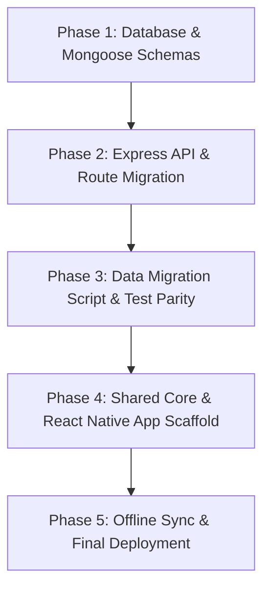

# MERN Stack Migration Plan for openGym

This document outlines the end-to-end architectural plan to migrate openGym from its current architecture (Zero-framework `node:http`, flat-file JSON storage, React 19 + Capacitor 8) to a **MERN Stack** (MongoDB + Express.js + React / React Native + Node.js).

---

## 1. Executive Summary & Objectives

### Current Architecture
* **Backend**: Node.js 22 with vanilla `node:http`, no framework, 3 production dependencies (`@simplewebauthn/server`, `web-push`, `undici`).
* **Persistence**: Flat-file JSON in `./data` (`db.json` and `state-<uid>.json`), with atomic writes via temporary files (`durable.js`).
* **Frontend / Mobile**: Single React 19 + Vite app wrapped with Capacitor 8 for Android and iOS, sharing 100% of the UI code between Web and Native.

### Target MERN Architecture
* **Database**: **MongoDB 7.0+** using **Mongoose ODM** for relational normalization, schema enforcement, indexing, and transactional integrity.
* **API Framework**: **Express.js 5.x** with modular routing, middleware pipelines (CORS, authentication, input validation, rate limiting), and structured error handling.
* **Client Layer**:
  * **Web**: React 19 + Vite (continued for browser and PWA deployment).
  * **Mobile**: **React Native (Expo / Bare workflow)** for true native UI components, animations, and background sensor integrations.
  * **Core Domain Logic**: A shared internal package (`@opengym/core`) extracting `src/lib/` (progression rules, 1RM calculations, fatigue models) for zero logic duplication.
* **Runtime**: Node.js 22 LTS containerized via Docker.

---

## 2. Architecture Comparison

| Component | Current Stack | Proposed MERN Stack |
|---|---|---|
| **Server Framework** | Native `node:http` (custom router map) | **Express.js 5.x** |
| **Database** | Plain JSON files (`./data/*.json`) | **MongoDB 7.x** + **Mongoose ODM** |
| **Data Model** | Monolithic JSON document per user | Normalized Collections (Users, Workouts, Routines, Measurements) |
| **Mobile App** | Capacitor 8 (WebView over React DOM) | **React Native** (Native UI widgets & threads) |
| **Code Sharing** | 100% shared React DOM codebase | Shared core math/domain logic via monorepo package |
| **Backups** | `tar czf backup.tar.gz ./data` | `mongodump` / automated replica volume snapshots |
| **Memory Footprint** | ~50 MB RAM idle | ~300 MB - 600 MB RAM idle (Node + Mongo) |

---

## 3. Database Schema Design (Mongoose)

Instead of storing each user's entire state as a single JSON blob (`state-<uid>.json`), data will be normalized into dedicated MongoDB collections.

### 3.1 Users Collection (`models/User.js`)
```javascript
import mongoose from 'mongoose';

const UserSchema = new mongoose.Schema({
  email: { type: String, sparse: true, trim: true, lowercase: true },
  username: { type: String, required: true, unique: true, trim: true },
  passwordHash: { type: String, select: false },
  role: { type: String, enum: ['user', 'admin'], default: 'user' },
  passkeys: [{
    credentialId: { type: String, required: true, unique: true },
    publicKey: { type: String, required: true },
    counter: { type: Number, default: 0 },
    transports: [String],
    backedUp: Boolean,
    createdAt: { type: Date, default: Date.now },
  }],
  pushSubscriptions: [{
    endpoint: String,
    keys: { p256dh: String, auth: String },
    deviceLabel: String,
  }],
  settings: {
    unitWeight: { type: String, enum: ['kg', 'lb'], default: 'kg' },
    unitDistance: { type: String, enum: ['km', 'mi'], default: 'km' },
    theme: { type: String, default: 'system' },
    restTimerSound: { type: Boolean, default: true },
  },
  lastRevision: { type: Number, default: 1 },
}, { timestamps: true });

export const User = mongoose.model('User', UserSchema);
```

### 3.2 Workouts Collection (`models/Workout.js`)
```javascript
import mongoose from 'mongoose';

const WorkoutSetSchema = new mongoose.Schema({
  type: { type: String, enum: ['normal', 'warmup', 'drop', 'failure'], default: 'normal' },
  weight: { type: Number, required: true }, // Normalized to kg in database
  reps: { type: Number },
  rpe: { type: Number, min: 1, max: 10 },
  durationSeconds: { type: Number },
  distanceMeters: { type: Number },
  completed: { type: Boolean, default: true },
});

const WorkoutExerciseSchema = new mongoose.Schema({
  exerciseId: { type: String, required: true, index: true },
  exerciseName: { type: String, required: true },
  notes: { type: String },
  sets: [WorkoutSetSchema],
});

const WorkoutSchema = new mongoose.Schema({
  userId: { type: mongoose.Schema.Types.ObjectId, ref: 'User', required: true, index: true },
  routineId: { type: mongoose.Schema.Types.ObjectId, ref: 'Routine' },
  routineName: { type: String },
  startedAt: { type: Date, required: true, index: true },
  finishedAt: { type: Date, required: true },
  notes: { type: String },
  exercises: [WorkoutExerciseSchema],
  prCount: { type: Number, default: 0 },
  totalVolume: { type: Number, default: 0 },
}, { timestamps: true });

WorkoutSchema.index({ userId: 1, startedAt: -1 });

export const Workout = mongoose.model('Workout', WorkoutSchema);
```

### 3.3 Routines Collection (`models/Routine.js`)
```javascript
import mongoose from 'mongoose';

const RoutineExerciseSlotSchema = new mongoose.Schema({
  exerciseId: { type: String, required: true },
  targetSets: { type: Number, default: 3 },
  targetReps: { type: String, default: '8-12' },
  restSeconds: { type: Number, default: 90 },
  progressionRule: {
    type: { type: String, enum: ['linear', 'double', 'triple', 'greyskull', 'none'], default: 'linear' },
    increment: { type: Number, default: 2.5 },
    deloadPercent: { type: Number, default: 10 },
  },
});

const RoutineSchema = new mongoose.Schema({
  userId: { type: mongoose.Schema.Types.ObjectId, ref: 'User', required: true, index: true },
  name: { type: String, required: true },
  folder: { type: String, default: 'General' },
  order: { type: Number, default: 0 },
  exercises: [RoutineExerciseSlotSchema],
}, { timestamps: true });

export const Routine = mongoose.model('Routine', RoutineSchema);
```

### 3.4 Body Measurements Collection (`models/Measurement.js`)
```javascript
import mongoose from 'mongoose';

const MeasurementSchema = new mongoose.Schema({
  userId: { type: mongoose.Schema.Types.ObjectId, ref: 'User', required: true, index: true },
  date: { type: Date, required: true, index: true },
  weightKg: { type: Number },
  bodyFatPercentage: { type: Number },
  circumferencesCm: {
    neck: Number,
    chest: Number,
    waist: Number,
    hips: Number,
    bicepsLeft: Number,
    bicepsRight: Number,
    thighLeft: Number,
    thighRight: Number,
    calves: Number,
  },
  customFields: [{
    name: String,
    value: Number,
    unit: { type: String, enum: ['cm', 'in', '%', 'kg', 'lb', 'none'] },
  }],
}, { timestamps: true });

MeasurementSchema.index({ userId: 1, date: -1 }, { unique: true });

export const Measurement = mongoose.model('Measurement', MeasurementSchema);
```

---

## 4. Backend Restructuring (Express.js)

### 4.1 Server Structure
```
api/
  src/
    config/
      database.js        # Mongoose connection & pool config
      env.js             # Environment variables validation
    controllers/
      authController.js  # WebAuthn passkeys & password login
      workoutController.js
      routineController.js
      measurementController.js
      syncController.js
    middlewares/
      authMiddleware.js  # HMAC session & Bearer token verification
      errorHandler.js    # Centralized JSON error response
      validator.js       # Zod / Joi validation middleware
    models/
      User.js
      Workout.js
      Routine.js
      Measurement.js
    routes/
      authRoutes.js
      workoutRoutes.js
      routineRoutes.js
      measurementRoutes.js
      syncRoutes.js
    app.js               # Express application initialization
    server.js            # Port binding & graceful shutdown
```

### 4.2 Middleware Pipeline
1. **Security**: `helmet()` for secure HTTP headers, `cors({ origin: env.ORIGIN, credentials: true })`.
2. **Body Parsers**: `express.json({ limit: '10mb' })` (support photo uploads/bulk imports).
3. **Session / Auth**: Cookie parser extracting session HMAC, plus `Authorization: Bearer <token>` support for mobile & tokens.
4. **Validation**: Zod schema middleware validating query parameters and payloads against OpenAPI specifications.
5. **Rate Limiting**: `express-rate-limit` backed by Redis or in-memory store for sensitive auth endpoints (`/api/auth/verify`).

---

## 5. Frontend & Mobile Strategy (React & React Native)

### 5.1 Extracting Shared Domain Logic (`@opengym/core`)
All training math and domain policies are completely pure functions and have 0 DOM dependencies. They will be hoisted into a shared package:
* `progression.js`: Linear, double, triple, and Greyskull progression calculators.
* `onerm.js`: 1RM estimation formulas (Brzycki, Epley, Wathan).
* `warmup-ramp.js`: Automated plate math and warm-up calculations.
* `recovery.js`: Fatigue calculations and muscle balance algorithms.
* `sync-merge.js`: Conflict resolution for offline merges.

### 5.2 React Native Architecture
* **Stack**: React Native 0.76+ (New Architecture / TurboModules) with **Expo Prebuild**.
* **State Management**: **Zustand** stores mirrored from the React web app.
* **Offline Storage**: **MMKV** or **OP-SQLite** for ultra-fast local persistence, keeping workouts functional during zero-connectivity gym sessions.
* **UI & Navigation**:
  * Navigation: `react-navigation` (Native Stack + Bottom Tabs).
  * Design System: Custom React Native UI components matching the existing openGym aesthetic (`#111` dark mode, high-contrast badges, SVG charts).
* **Wearable Strategy**:
  * Apple Watch: Shared Swift WatchKit code connected via Native Module bridge (`WCSession`).
  * Wear OS: Retain Kotlin Compose watch module communicating via Google Data Layer API.
  * Garmin: Retain Connect IQ Monkey C app.

---

## 6. Migration Script: Flat JSON to MongoDB

A standalone CLI script (`scripts/migrate-to-mongodb.mjs`) will convert legacy `./data` directories:

```javascript
import fs from 'node:fs';
import path from 'node:path';
import mongoose from 'mongoose';
import { User } from '../api/src/models/User.js';
import { Workout } from '../api/src/models/Workout.js';
import { Routine } from '../api/src/models/Routine.js';
import { Measurement } from '../api/src/models/Measurement.js';

export async function migrateDataDirectory(dataDir, mongoUri) {
  await mongoose.connect(mongoUri);
  console.log('Connected to MongoDB');

  // 1. Migrate Users & Credentials from db.json
  const dbFile = path.join(dataDir, 'db.json');
  if (fs.existsSync(dbFile)) {
    const raw = JSON.parse(fs.readFileSync(dbFile, 'utf8'));
    for (const [uid, userRecord] of Object.entries(raw.users || {})) {
      const user = await User.findOneAndUpdate(
        { username: userRecord.username || uid },
        {
          username: userRecord.username || uid,
          passkeys: (userRecord.credentials || []).map(c => ({
            credentialId: c.id,
            publicKey: c.publicKey,
            counter: c.counter || 0,
          })),
        },
        { upsert: true, new: true }
      );

      // 2. Migrate User State (state-<uid>.json)
      const stateFile = path.join(dataDir, `state-${uid}.json`);
      if (fs.existsSync(stateFile)) {
        const state = JSON.parse(fs.readFileSync(stateFile, 'utf8'));

        // Workouts
        if (Array.isArray(state.history)) {
          const workouts = state.history.map(w => ({
            userId: user._id,
            startedAt: new Date(w.start),
            finishedAt: new Date(w.end),
            notes: w.notes,
            exercises: (w.exercises || []).map(e => ({
              exerciseId: e.id,
              exerciseName: e.name,
              sets: (e.sets || []).map(s => ({
                weight: s.weight || 0,
                reps: s.reps || 0,
                type: s.type || 'normal',
                completed: s.done !== false,
              })),
            })),
          }));
          if (workouts.length) await Workout.insertMany(workouts);
        }

        // Routines
        if (Array.isArray(state.routines)) {
          const routines = state.routines.map(r => ({
            userId: user._id,
            name: r.name,
            folder: r.folder || 'General',
            exercises: (r.exercises || []).map(e => ({
              exerciseId: e.id,
              targetSets: e.sets || 3,
              targetReps: e.reps || '8-12',
            })),
          }));
          if (routines.length) await Routine.insertMany(routines);
        }

        // Measurements
        if (Array.isArray(state.measurements)) {
          const measurements = state.measurements.map(m => ({
            userId: user._id,
            date: new Date(m.date),
            weightKg: m.weight,
            bodyFatPercentage: m.bodyFat,
            circumferencesCm: m.circumferences || {},
            customFields: m.custom || [],
          }));
          if (measurements.length) await Measurement.insertMany(measurements);
        }
      }
    }
  }

  console.log('Migration complete.');
  await mongoose.disconnect();
}
```

---

## 7. Containerization & Deployment

### Updated `docker-compose.yml`
```yaml
services:
  mongodb:
    image: mongo:7.0
    restart: unless-stopped
    environment:
      MONGO_INITDB_ROOT_USERNAME: ${MONGO_ROOT_USER:-opengym}
      MONGO_INITDB_ROOT_PASSWORD: ${MONGO_ROOT_PASSWORD:?Required}
      MONGO_INITDB_DATABASE: opengym
    volumes:
      - mongo-data:/data/db
    ports:
      - "127.0.0.1:27017:27017"

  api:
    build:
      context: ./api
    restart: unless-stopped
    depends_on:
      - mongodb
    environment:
      - PORT=3000
      - MONGO_URI=mongodb://${MONGO_ROOT_USER:-opengym}:${MONGO_ROOT_PASSWORD}@mongodb:27017/opengym?authSource=admin
      - SESSION_SECRET=${SESSION_SECRET:?Required}
      - ORIGIN=${ORIGIN:-http://localhost:8080}
      - RP_ID=${RP_ID:-localhost}
    volumes:
      - ./uploads:/data/uploads

  web:
    build:
      context: .
      dockerfile: web/Dockerfile
    restart: unless-stopped
    depends_on:
      - api
    ports:
      - "${WEB_PORT:-8080}:80"

volumes:
  mongo-data:
```

---

## 8. Implementation Roadmap (5 Phases)



### Phase 1: Database & Mongoose Schemas (Week 1)
* Spin up MongoDB 7.0 container.
* Define and unit-test Mongoose schemas (`User`, `Workout`, `Routine`, `Measurement`).
* Write database indexes and connection lifecycle management.

### Phase 2: Express.js API Migration (Weeks 2-3)
* Install Express 5.x, CORS, Helmet, and Cookie Parser.
* Port all endpoints from `routes['METHOD /path']` to dedicated Express Routers.
* Reconnect WebAuthn passkey registration/authentication (`@simplewebauthn/server`).
* Ensure OpenAPI spec tests pass (`openapi-routes.test.js`).

### Phase 3: Data Migration & Test Verification (Week 4)
* Build and verify `scripts/migrate-to-mongodb.mjs` against real backup datasets.
* Verify concurrent sync and multi-client update conflict handling.
* Run full API automated integration test suite (`node --test`).

### Phase 4: Shared Core Monorepo & React Native Scaffold (Weeks 5-7)
* Restructure repository as an npm/pnpm workspace.
* Move `frontend/src/lib` domain algorithms to `@opengym/core`.
* Scaffold React Native (Expo) app with React Navigation and Zustand.
* Port primary workout tracker screens, timers, and active session sheets to native components.

### Phase 5: Offline Sync, Wearable Integration & Release (Weeks 8-9)
* Implement local MMKV offline cache with background sync to `/api/sync`.
* Wire native Apple Watch (`WatchConnectivity`) and Wear OS bridges.
* Update Docker Compose, Helm charts, and documentation.

---

## 9. Key Trade-offs & Operational Impact

1. **Hardware Footprint**: Memory usage increases from ~50 MB to ~350 MB due to the MongoDB daemon. Single-board computers (e.g. Raspberry Pi 3) will require at least 1 GB RAM.
2. **Backup Workflow**: Simple file copies are replaced by `mongodump` or volume snapshot automation.
3. **Multi-Platform Codebase**: Transitioning from 100% shared React DOM code (Capacitor) to React Web + React Native requires maintaining two UI layers while sharing the core domain logic.
